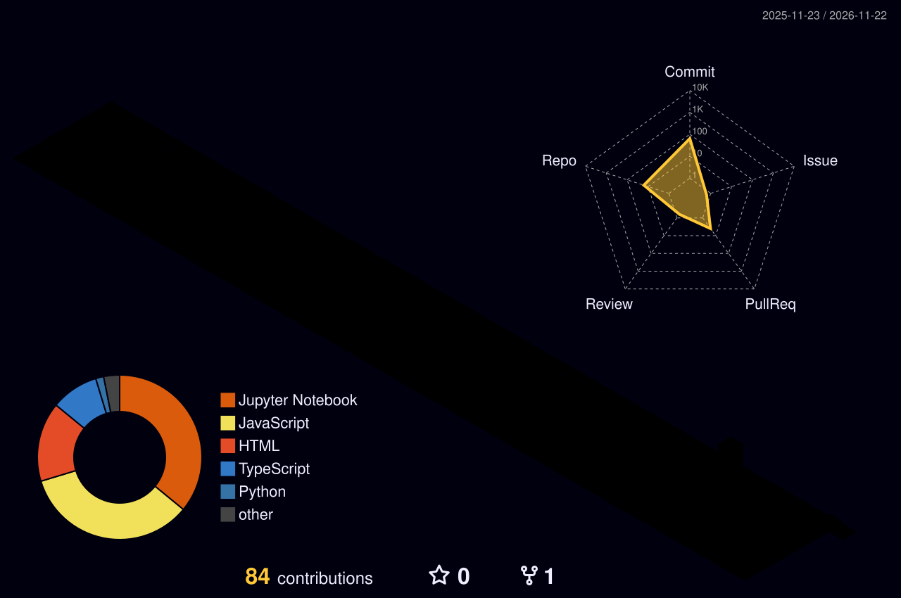

<div align="center">


<a href="https://git.io/typing-svg">
  
</a>

<br>

<a href="https://www.prakashkarekar.dev/">
  
</a>
<a href="https://github.com/Anonymous-0P">
  
</a>
<a href="mailto:prakashkarekar4@gmail.com">
  
</a>

</div>

---

## About Me

I am **Prakash Karekar**, a Software Developer based in Belagavi, Karnataka, India.

My interests span software engineering, artificial intelligence, cloud computing, cybersecurity, enterprise applications and modern web and mobile development.

I am passionate about building secure, scalable and intelligent software solutions that address real-world challenges.

```yaml
developer:
  name: Prakash Karekar
  location: Belagavi, Karnataka, India
  role: Software Developer

  domains:
    - Artificial Intelligence
    - Software Engineering
    - Cybersecurity
    - Cloud Computing
    - DevOps
    - Enterprise Applications
    - Mobile Development

  philosophy: Learn. Build. Innovate.
```

---

## Technology Stack

<div align="center">

### Programming Languages


### Frontend & Backend Development


### Artificial Intelligence & Machine Learning


### Cloud Computing & DevOps


### Database Technologies


### Development Environment


</div>

---

## Core Expertise

| Domain | Focus Areas |
|:---|:---|
| Software Engineering | Application Development, Software Architecture, REST APIs |
| Artificial Intelligence | Machine Learning, Generative AI, Intelligent Applications |
| Cybersecurity | Network Security, Ethical Hacking, Secure Development |
| Cloud Computing | Cloud Infrastructure, VPS, Application Deployment |
| DevOps | Containerization, Version Control, Infrastructure Automation |
| Enterprise Systems | ERPNext, Frappe Framework, Business Process Automation |
| Web Development | Responsive Interfaces, Frontend and Backend Development |
| Mobile Development | Mobile Applications and Digital Experiences |

---

## Featured Projects

### Rotra Logistics

A featured software project focused on the logistics domain.

### Enterprise Application Development

Exploring enterprise software solutions, business process automation and system integration.

### Intelligent Applications

Developing and exploring AI-powered applications that solve practical problems.

<div align="center">

<a href="https://github.com/Anonymous-0P?tab=repositories">
  
</a>

</div>

---

## GitHub Analytics

<div align="center">


<br><br>


</div>

---

## 3D Contribution Graph

<div align="center">



</div>

---

## Contribution Activity

<div align="center">


</div>

---

## Current Focus

- Artificial Intelligence and intelligent automation
- Cloud-native application development
- Secure and scalable software architecture
- Enterprise application development
- DevOps and infrastructure automation
- Continuous learning and innovation

---

## Engineering Philosophy

> Technology is not just about writing code. It is about designing meaningful solutions, solving complex problems and creating lasting impact.

---

## Connect With Me

<div align="center">

<a href="https://www.prakashkarekar.dev/">
  
</a>

<a href="https://github.com/Anonymous-0P">
  
</a>

<a href="mailto:prakashkarekar4@gmail.com">
  
</a>

<br><br>

**Learn. Build. Innovate.**


</div>
